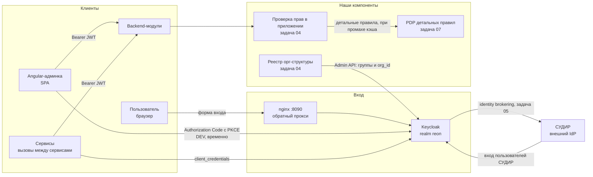

# reon-auth-server

Единая точка аутентификации и авторизации РЕОНа: общий Keycloak для всех
модулей и административного фронтенда. Прямой обмен фронтенда с Keycloak —
временное решение для отладки, в будущем планируется BFF. Стандарт подключения
сервисов и собственная авторизация (иерархический RBAC и ABAC) поверх claims
JWT.

Незнакомые термины (RBAC, ABAC, OIDC, ROPC, JWT и другие) разобраны в
[глоссарии](#глоссарий) в конце файла.

## Текущее состояние

- Своей реализации входа не планируется: аутентификация полностью закрыта
  настроенным Keycloak, описанным кодом (задача local-20261101-01, закрыта).
- DEV-стенд воспроизводится из чистого клона; smoke-скрипты (bash и pwsh,
  52 проверки) подтверждают контракт токенов.
- Административный фронтенд (Angular) подключается к Keycloak напрямую по
  OIDC Authorization Code и PKCE — это временная схема для отладки; 
  продуктовая схема web-входа (BFF) отложена и описана в задачах.
- Авторизация сейчас: роли и `org_id` в JWT, проверка на стороне модулей.
  Реестр орг-структуры и детальные правила — задачи 04-07.

## Быстрый старт DEV-стенда

Требования: Docker Engine и Docker Compose.

```bash
# .env не обязателен: без него работают dev-значения по умолчанию
docker compose up -d
# дождаться, пока применятся realm и синтетические данные
docker wait reon-auth-keycloak-init reon-auth-synthetic-init
bash scripts/smoke-auth.sh        # или: pwsh -File scripts/smoke-auth.ps1
```

`docker compose up -d` возвращает управление раньше, чем отработают one-shot
сервисы `reon-auth-keycloak-init` и `reon-auth-synthetic-init`. Без `docker wait`
smoke может упасть на ещё не созданных клиентах и пользователях. Повторный
запуск любого из init-сервисов безопасен: оба идемпотентны.

| Сервис | Адрес | Назначение |
|---|---|---|
| nginx (точка входа) | `http://localhost:8090` | issuer, discovery, токены, форма входа, Admin REST API; лимиты заголовков ≥ 32 КБ |
| Keycloak напрямую | `http://localhost:8084` | консоль администратора и прямой доступ к API при отладке |
| Postgres Keycloak | `localhost:5434` | внутренняя БД IdP |

Консоль администратора открывается только на прямом порту
`http://localhost:8084/admin/`: публичный адрес issuer задан через
`KC_HOSTNAME`, а админка — через `KC_HOSTNAME_ADMIN`, поэтому через прокси
страница консоли отвечает 404, и это осознанно. Admin REST API при этом
доступен и через прокси: им пользуются smoke-проверки и воркер синхронизации.

Issuer: `http://localhost:8090/realms/reon`. Конфигурация realm и dev-данные
применяются one-shot сервисом `reon-auth-keycloak-init` (keycloak-config-cli)
идемпотентно; источник истины — `docker/keycloak/realm.yml` и
`docker/keycloak/dev-users.yml`.

Занятые порты стенда аутентификации: 8090, 8084, 5434. Порты 8080-8082 и 5433
заняты смежным стендом `reon-s3-*` — не использовать.

## Клиенты и потоки

| Клиент | Тип | Поток | Кто использует |
|---|---|---|---|
| `reon-admin-web` | public | Authorization Code с PKCE S256 | Angular-админка (dev-схема напрямую) |
| `reon-api` | аудитория | без собственного потока | значение `aud` для API модулей |
| `reon-service` | confidential | client_credentials | межсервисные вызовы |
| `reon-dev-smoke` | confidential | ROPC (direct grants) | только smoke-тесты, DEV; в продукте запрещён |

Dev-пользователи (пароли — в `docker/keycloak/dev-users.yml`, только для
стенда): `dev-admin` (мастер-админ), `dev-finance`, `dev-branch`.

## Синтетические данные

Стенд сам создаёт данные для проверки сценариев модулей: клиенты сервисов и
12 пользователей. Применяются one-shot сервисом `reon-auth-synthetic-init`
через partial import, повторный запуск безопасен.

Клиенты сервисов (секреты — dev-заглушки, задаются в `.env`):

| Клиент | Тип | Как получает токен | Секрет по умолчанию |
|---|---|---|---|
| `reon-admin-panel` | public | Authorization Code с PKCE | не используется |
| `reon-process-ui` | public | Authorization Code с PKCE | не используется |
| `mdm-service` | confidential | client_credentials | `dev-mdm-service-secret-change-me` |
| `reon-s3-server` | confidential | client_credentials | `dev-reon-s3-server-secret-change-me` |
| `reon-process-backend` | confidential | client_credentials | `dev-reon-process-backend-secret-change-me` |

Пользователи (пароль — `<username>-pass`):

| Пользователь | Группа | Что проверяет |
|---|---|---|
| `syn-mdm-editor` | `/reon/hq` | запись мастер-данных |
| `syn-mdm-reader` | `/reon/branch-1` | чтение мастер-данных из филиала |
| `syn-s3-operator` | `/reon/hq` | запись и чтение файлов |
| `syn-s3-reader` | `/reon/branch-1` | только чтение файлов |
| `syn-camunda-designer` | `/reon/hq` | запуск процессов |
| `syn-camunda-viewer` | `/reon/branch-1` | только чтение процессов |
| `syn-finance-lead` | `/reon/hq/finance` | отчёты и мастер-данные |
| `syn-finance-analyst` | `/reon/hq/finance` | отчёты без удаления |
| `syn-branch-employee-1` | `/reon/branch-1` | базовый доступ филиала |
| `syn-branch-employee-2` | `/reon/branch-1` | базовый доступ филиала |
| `syn-auditor` | `/reon/hq` | сквозное чтение для проверок |
| `syn-admin` | `/reon/admins` и `/reon/hq` | `MASTER_ADMIN` |

Проверить данные вручную:

```bash
curl -s -X POST http://localhost:8090/realms/reon/protocol/openid-connect/token \
  -d grant_type=password \
  -d client_id=reon-dev-smoke \
  -d client_secret=dev-reon-dev-smoke-secret-change-me \
  -d username=syn-mdm-editor -d password=syn-mdm-editor-pass
```

Ограничение: partial import применяется со стратегией `SKIP`, поэтому правка
существующего синтетического пользователя или клиента в JSON не применится к
живому стенду. Чтобы применить заново, пересоздайте том
(`docker compose down -v`) или импортируйте ресурс через Admin API.

## Контракт JWT

| Claim | Источник | Смысл |
|---|---|---|
| `realm_access.roles` | роли групп Keycloak | capabilities вида `report:read`, `MASTER_ADMIN` |
| `groups` | полные пути групп | орг-иерархия; организации — пути орг-дерева, кроме служебной `/reon/admins` |
| `org_id` | атрибут пользователя (DEV-зеркало атрибута группы) | якорь тенанта для фильтрации данных |
| `aud` | audience mapper | содержит `reon-api` для токенов пользователей и сервисов |
| `azp` | стандартный | кто запросил токен; для сервис-токенов авторизация по `aud`+`azp` |

Времена жизни: access 900 секунд, refresh-окно 8 часов (DEV). Роли назначаются
группам, не пользователям; `MASTER_ADMIN` живёт на служебной группе
`/reon/admins` и даёт сквозной доступ мимо проверок тенанта.

Подробные требования к валидации и подключению — `docs/standards/service-auth.md`;
архитектурные решения — `docs/adr/0001-authn-authz-architecture.md`.

## Целевая архитектура

Схема — в формате Mermaid: она рендерится в GitHub, GitLab, JetBrains IDE и
Obsidian и хранится рядом с текстом, поэтому не расходится с ним.



Отложено: BFF (задача 06) — браузер обращается к серверу приложения по
сессионной куке, а тот обменивает код на токены, так что токены не попадают
в браузер. На схеме не показан, чтобы не выдавать отложенное за действующее.

СУДИР не заменяет Keycloak: это будущий федеративный источник аутентификации
своих пользователей (identity brokering, задача 05); формовая аутентификация
Keycloak остаётся.

## Дорожная карта задач

Дорожная карта, статусы и подробные описания задач перенесены в
`docs/plan/README.md`. Эпик и решения по архитектуре — `docs/plan/epic-01-reon-auth.md`
и `docs/adr/0001-authn-authz-architecture.md`; рабочие ТЗ и отчёты — на доске
`.agents/tasks/<task-id>/`.

## Структура репозитория

```
docker-compose.yml          DEV-стенд: Keycloak, nginx, Postgres, init
docker/keycloak/            realm и dev-данные как код (keycloak-config-cli)
docker/nginx/               конфигурация reverse proxy
scripts/                    smoke-проверки стенда (bash и pwsh)
docs/adr/                   архитектурные решения
docs/standards/             стандарты подключения сервисов
docs/plan/                  эпики, дорожные карты, описания задач
.agents/                    доска задач агентов: brief, results, reduce, journal
```

## Известные ограничения DEV-стенда

- keycloak-config-cli не удаляет роли групп и членства, убранные из конфига:
  правки «на удаление» на живом стенде требуют точечной очистки через Admin
  API; чистый клон воспроизводится корректно. Оценку `IMPORT_MANAGED_*`
  см. в задаче 08.
- `org_id` в DEV выдаётся из атрибута пользователя (зеркало атрибута группы):
  рассинхрон дубля возможен при ручных перемещениях пользователей; задача 04
  делает группу источником истины.
- Консоль администратора Keycloak намеренно не проксируется: она живёт на
  прямом порту 8084 (`KC_HOSTNAME_ADMIN`), через прокси `/admin/` отвечает
  404. Admin REST API через прокси доступен: он нужен smoke-проверкам и
  воркеру синхронизации.
- ROPC включён только у `reon-dev-smoke`; в продуктовых интеграциях запрещён.

## Открытые вопросы

- Инициализация git в репозитории: доска задач работает без push, но коммиты
  по `CONTRIBUTIONS.md` требуют репозиторий. Решение — за владельцем проекта.
- Полные версии диаграмм аутентификации (wiki pageId=36012151): PDF обрезаны
  справа; понадобятся для задачи 06 (BFF).
- Контракт СУДИР (протокол, endpoints, состав пользователей) — от владельца
  системы; детальные правила доступа — от владельцев продукта.

## Глоссарий

Термины сгруппированы по смыслу: сначала базовые понятия, потом токены,
клиенты и модель прав. Для каждого указано, зачем он нам нужен.

### Базовые понятия

**IAM** (Identity and Access Management, управление идентификацией и
доступом) — общее название класса систем, которые ведут учётные записи и
права. Keycloak относится к IAM. В разговорах «наша IAM» означает всю
подсистему: вход, пользователи, роли, права.

**IdP** (Identity Provider, поставщик идентичности) — система, которая
проводит вход и выдаёт токен. У нас IdP — Keycloak; в будущем для части
пользователей добавится СУДИР как федеративный источник.

**Keycloak** — готовый сервер аутентификации с открытым кодом. Мы его
настраиваем, а не пишем: пользователи, группы, роли, клиенты и токены живут
в нём.

**Realm** — изолированное пространство внутри Keycloak со своими
пользователями, ролями и клиентами. У нас два: `master` (служебный, только
для администраторов Keycloak) и `reon` (рабочий, там наши пользователи).

**SSO** (Single Sign-On, единый вход) — один вход даёт доступ ко многим
приложениям без повторного пароля. Работает за счёт того, что все приложения
доверяют одному IdP.

**СУДИР** — внешняя система заказчика, которая аутентифицирует своих
пользователей. Она не заменяет Keycloak: мы подключаем её как источник входа
(задача 05), а права по-прежнему считаем сами.

### Многофакторный вход

**MFA** (Multi-Factor Authentication, многофакторная аутентификация) — вход,
где нужно подтвердить личность двумя и более независимыми способами:
знанием (пароль), владением (телефон, аппаратный ключ), свойством (отпечаток
пальца, лицо). Пароль может утечь, второй фактор резко снижает риск входа
злоумышленника. Keycloak поддерживает MFA из коробки; у нас на DEV он пока
не включён, чтобы smoke-проверки и тесты оставались простыми.

**2FA** (Two-Factor Authentication, двухфакторная аутентификация) — частный
случай MFA, когда факторов ровно два: пароль и, например, одноразовый код.

**OTP** (One-Time Password, одноразовый пароль) — код, который действует
один раз и короткое время. Если его перехватили и уже использовали, повторно
он не сработает.

**TOTP** (Time-based One-Time Password, одноразовый пароль на основе
времени) — код, который приложение-аутентификатор вычисляет из общего секрета
и текущего времени; обычно обновляется каждые 30 секунд. Самый
распространённый вариант OTP в корпоративных системах.

**HOTP** (HMAC-based One-Time Password) — тот же принцип, но код зависит от
счётчика использований, а не от времени. Встречается реже.

**Код по электронной почте или SMS** — тоже OTP, но слабее TOTP: письмо
можно перехватить, номер — перенести на другую SIM-карту. Как единственный
второй фактор нежелателен.

**WebAuthn и FIDO2** — вход по аппаратному ключу (например, USB-токен) или
по биометрии устройства. Устойчив к фишингу, потому что ключ проверяет
настоящий домен сайта. Считается самым надёжным вторым фактором.

**Step-up** (повышение требований) — запрос дополнительного фактора не при
входе, а перед чувствительной операцией: например, пароль для входа, а код
подтверждения — перед сменой реквизитов. У нас пока не требуется, но модель
ролей это не запрещает.

Состояние у нас: политику OTP и обязательные действия Keycloak настраивает
без кода приложения (в realm есть настройки OTP, обязательные действия
пользователя и условные сценарии входа). Включение MFA для продуктовых
пользователей, выбор факторов и правила step-up относятся к задаче 08 и к
требованиям заказчика; на DEV остаётся вход по паролю.

### Протоколы и токены

**OIDC** (OpenID Connect) — современный протокол входа поверх OAuth 2.0:
приложение перенаправляет пользователя к IdP, получает код, меняет его на
токен с данными о пользователе. Именно его использует Angular-админка и наши
сервисы.

**OAuth 2.0** — протокол выдачи доступа к ресурсам без передачи пароля.
Описывает, как получить токен; OIDC добавляет к нему сведения о том, кто
пользователь.

**SAML** — более старый протокол обмена данными о входе в формате XML.
Используется в корпоративных системах; для СУДИР возможен как вариант
интеграции, если он поддерживает только SAML.

**JWT** (JSON Web Token) — подписанный токен в формате JSON. Внутри —
утверждения о пользователе (кто он, какие роли, к какой организации
относится). Подпись позволяет проверить токен, не спрашивая IdP на каждом
запросе.

**Claims** (утверждения) — пары «имя и значение» внутри JWT: `sub`
(идентификатор пользователя), `groups` (группы), `org_id` (организация),
`realm_access.roles` (роли), `aud` (для кого токен), `exp` (срок действия).
Модуль читает claims и по ним принимает решение.

**issuer** (издатель, claim `iss`) — адрес IdP, который выпустил токен.
Модуль обязан проверить, что это именно наш Keycloak, иначе примет токен
чужой системы.

**audience** (аудитория, claim `aud`) — для какого приложения выпущен токен.
У нас пользовательские и сервисные токены содержат `reon-api`, чтобы модуль
не принимал токены, выданные для другого потребителя.

**azp** (authorized party) — клиент, который запросил токен. По нему
сервисные вызовы отличаются от пользовательских: у сервиса `azp` равен
`reon-service`.

**JWKS** (JSON Web Key Set) — набор открытых ключей IdP. Модуль один раз
загружает его и проверяет подпись токенов локально, без обращения к Keycloak
на каждый запрос.

**Access-токен** — короткоживущий токен для доступа к API (у нас 15 минут).

**Refresh-токен** — более долгоживущий токен, которым клиент обновляет
access-токен без повторного ввода пароля.

**PKCE** (Proof Key for Code Exchange) — защита входа для публичных
клиентов: клиент придумывает секрет, отправляет его хеш при запросе кода и
сам секрет при обмене кода на токен. Не даёт перехватить код. Для
Angular-админки обязателен.

**Authorization Code** — основной сценарий входа по OIDC: браузер получает
одноразовый код, сервер или клиент меняет его на токен.

### Клиенты и способы получить токен

**Клиент** — приложение, зарегистрированное в Keycloak со своим
идентификатором и настройками.

**Public-клиент** — клиент без секрета, обычно браузерное приложение. Секрет
в браузере хранить нельзя, поэтому его защищает PKCE. У нас это
`reon-admin-web`.

**Confidential-клиент** — клиент с секретом, работает на сервере. У нас
`reon-service` и `reon-dev-smoke`.

**ROPC** (Resource Owner Password Credentials) — устаревший сценарий, когда
логин и пароль передаются приложению напрямую. Мы используем его только для
smoke-проверок на DEV (`reon-dev-smoke`); в продукте запрещён, потому что
приложение видит пароль.

**client_credentials** — сценарий для сервисных вызовов: приложение
предъявляет свой идентификатор и секрет и получает токен без пользователя.
Так сервисы ходят друг к другу.

**SPA** (Single Page Application) — браузерное приложение, например
Angular-админка. Токены живут в памяти вкладки, не в localStorage.

**BFF** (Backend for Frontend, серверная часть для фронтенда) — серверный
посредник: браузер общается с ним по сессионной куке, а он уже обменивает код
на токены. Токены не покидают сервер. У нас отложено (задача 06), сейчас
админка ходит в Keycloak напрямую.

### Модель прав

**RBAC** (Role-Based Access Control, доступ на основе ролей) — права
выдаются ролям, а роли назначаются пользователям или группам. У нас роль
описывает, что можно делать: `report:read`, `report:delete`. Такой подход
даёт понятный ответ на вопрос «может ли пользователь читать отчёты».

**ABAC** (Attribute-Based Access Control, доступ на основе атрибутов) —
решение принимается по атрибутам: организации, подразделению, статусу
объекта. У нас главный атрибут — `org_id`: он говорит, над данными какой
организации пользователь работает. RBAC отвечает «что можно», ABAC — «над
чьими данными».

**Capability** (возможность) — конкретная роль вида `resource:action`,
например `report:read`. Назначается группе, а не отдельному пользователю.

**Группа** — узел орг-дерева в Keycloak: `/reon/hq`, `/reon/hq/finance`,
`/reon/branch-1`. Группа несёт организацию и роли, а вложенность задаёт
наследование вниз.

**Тенант** (организация) — владелец данных с неизменяемым
идентификатором `org_id`. Все узлы одной организации делят один `org_id`,
а иерархию внутри задают пути групп.

**org_id** — UUID организации, попадающий в токен. По нему модуль фильтрует
данные и проверяет, что запрос не выходит за пределы своей организации.

**MASTER_ADMIN** — роль сквозного администратора: даёт доступ к данным любой
организации мимо проверок иерархии. Живёт на служебной группе
`/reon/admins`, а не на орг-узле, иначе роль унаследовали бы все подгруппы.

**PDP** (Policy Decision Point, точка принятия решений) — компонент, который
по правилам отвечает «можно или нельзя». В задаче 07 появится как сервис для
детальных правил (например, «черновик видит только автор»).

**PEP** (Policy Enforcement Point, точка применения) — место в модуле, где
решение PDP применяется к запросу. Грубые проверки по claims выполняются
прямо в приложении, без отдельного сервиса.

**ReBAC** (Relationship-Based Access Control, доступ на основе связей) —
модель, где права выводятся из графа отношений («пользователь — участник
проекта — документ»). Рассматривалась и отклонена: для нашего дерева
организаций она избыточна (см. ADR).

**RLS** (Row-Level Security, изоляция на уровне строк) — механизм Postgres,
который скрывает строки на уровне базы. Рассматривался как дополнительный
рубеж защиты, не как основной механизм (см. ADR).

### Проверки и процесс

**Smoke-тест** — короткий набор проверок, что стенд жив и контракт токенов не
сломан. У нас два равноценных скрипта: `scripts/smoke-auth.sh` и
`scripts/smoke-auth.ps1`, по 52 проверки.

**Бриф** (brief) — письменное задание на задачу: цель, границы, файлы,
критерии приёмки. Хранится на доске `.agents/tasks/<task-id>/`.

**Reduce** — итоговое решение по задаче: что принято, какие противоречия
разрешены, какие риски остались.

**Lease** — временное право сессии владеть задачей. Истёк — задачу может
забрать другая сессия с записью в журнал.
